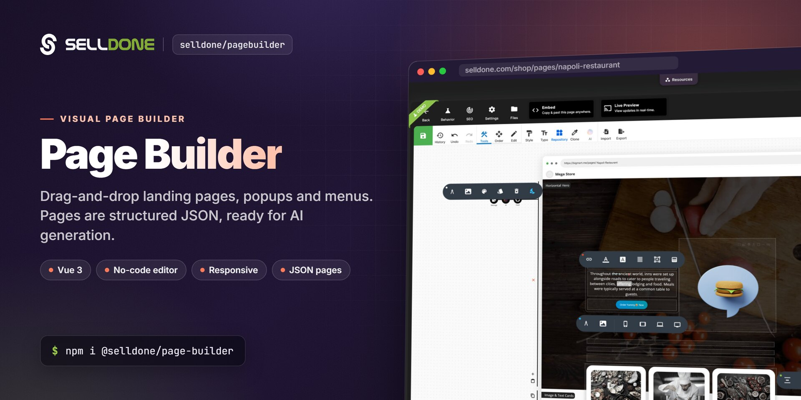
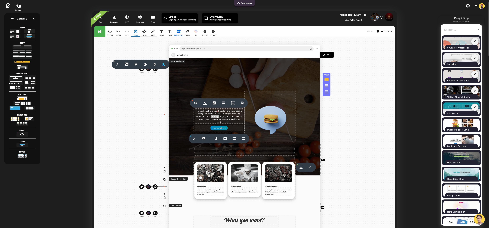

<p align="center">
  
</p>

<p align="center">
  <a href="https://www.npmjs.com/package/@selldone/page-builder"></a>
  <a href="https://www.npmjs.com/package/@selldone/page-builder"></a>
  <a href="LICENSE.md"></a>
  
  <a href="https://github.com/selldone/pagebuilder/wiki"></a>
  <a href="https://selldone.com"></a>
</p>

<p align="center">
  <b>A visual drag-and-drop page builder for Vue 3 that saves every page as structured JSON, for Selldone storefronts and dashboards.</b><br>
  <a href="https://github.com/selldone/pagebuilder/wiki">Documentation</a> ·
  <a href="#quick-start">Quick start</a> ·
  <a href="https://github.com/selldone">Ecosystem</a> ·
  <a href="https://selldone.com">Selldone.com</a> ·
  <a href="https://github.com/selldone/pagebuilder/issues">Report an issue</a>
</p>

<p align="center">
  <a href="https://github.com/selldone/storefront">Storefront</a> ·
  <b>Page Builder</b> ·
  <a href="https://github.com/selldone/components">Components</a> ·
  <a href="https://github.com/selldone/storefront-sdk">Storefront SDK</a> ·
  <a href="https://github.com/selldone/backoffice-sdk">Backoffice SDK</a> ·
  <a href="https://github.com/selldone/vendor-sdk">Vendor SDK</a> ·
  <a href="https://github.com/selldone/community-sdk">Community SDK</a> ·
  <a href="https://github.com/selldone/core">Core</a> ·
  <a href="https://github.com/selldone/cli">CLI</a> ·
  <a href="https://github.com/selldone/translate">Translate</a>
</p>

## Overview

**Selldone Page Builder** (`@selldone/page-builder`) is the in-line, visual page builder of
[Selldone®](https://selldone.com) Business OS. It is built with **Vue 3** and **Vuetify 3** and is published as an
open-source Vue components library. Merchants use it in the Selldone dashboard to design landing pages, popups and
custom menu pages; storefronts use the same package to render those pages for customers.

The builder is designed for professional output with no coding skills or extra plugins. You drag pre-built sections
onto an artboard, edit text in place, and style every element visually (typography, colors, backgrounds, borders,
animations, responsive columns). Pages render inside Selldone storefronts, which run as Progressive Web Apps (PWA),
so visitors get a fast, app-like experience on any device.

Every page is saved as **structured JSON**: a list of sections, each holding a tree of typed elements. Because the
format is predictable, pages can be generated, translated and edited by software, including AI tools, which makes
automated page building practical and keeps design quality consistent.

Use this package if you are building a custom Selldone storefront (a *Layout*), extending the Selldone dashboard, or
you want an open-source alternative to closed page builders, within the terms of the [license](#license).

## Key features

- **Two modes, one package** — `SetupPageBuilder(app, { mode: "view" })` renders pages for customers; `mode: "edit"` installs the full visual editor.
- **Structured JSON pages** — content is `{ title, style, sections[] }`; each section holds a tree of elements (`XSection`, `XContainer`, `XRow`, `XColumn`, `XText`, …) that is easy to store, diff and generate.
- **26 ready-made sections** — hero, text, article, image, gallery, store (product listings and single product), raw HTML, newsletter form, blog list and embedded page.
- **Commerce-aware elements** — product cards, product lists and filters, product overview, blog feeds and search are bound to live shop data through the [Storefront SDK](https://github.com/selldone/storefront-sdk).
- **Responsive by design** — per-device column widths (mobile, tablet, desktop, widescreen) and per-breakpoint visibility, plus "hide for guests" and "hide for users" rules per section.
- **Raw HTML and Vue code sections** — paste HTML or a small Vue template with configurable `properties`; see the [samples](_docs/samples/section-html).
- **Editor productivity** — undo and redo history, copy-style pipette, keyboard shortcuts, drag-and-drop sorting, hierarchy view, custom CSS, SEO and statistics panels.
- **Import and export** — save any page as a portable `.landing` file and load it into another shop.
- **Behavior heatmaps** — the renderer records mouse move, click and scroll data so merchants can review heatmaps of each page.
- **AI hooks** — optional `aiAutoFillFunction` (fill a section) and `aiPageGenerateFunction` (generate a page) props let you plug in your own content generator.
- **Backward compatible** — older (v1) page content is migrated to the current element model automatically when loaded.

## Screenshots



## Quick start

Install the package:

```bash
npm install @selldone/page-builder
```
```bash
yarn add @selldone/page-builder
```

The package ships TypeScript and `.vue` source files (`"main": "index.ts"`), so use a bundler that compiles Vue SFCs,
TypeScript and SCSS, such as Vite. It expects **Vue 3**, **Vuetify 3** and the Selldone packages
[`@selldone/core-js`](https://github.com/selldone/core), [`@selldone/sdk-storefront`](https://github.com/selldone/storefront-sdk)
and [`@selldone/components-vue`](https://github.com/selldone/components), which are installed as dependencies.

Here's a basic example to get you started:

```javascript
import {SetupPageBuilder} from "@selldone/page-builder";

//――――――――― Page Builder (View Mode) ―――――――――

SetupPageBuilder(app, { mode: "view" });

// or

//――――――――― Page Builder (Edit Mode) ―――――――――
SetupPageBuilder(app, {
   mode: "edit",
   server: {
      uploadImageUrl: (type, model) => {
         if (type === "page") {
            // Shop landing pages:
            return window.API.POST_UPLOAD_PAGE_IMAGE(model.shop_id, model.id);
         } else if (type === "menu") {
            // Shop custom page for menus:
            return window.API.POST_UPLOAD_PAGE_IMAGE(model.shop_id, "default"); // Save in default (For menus / notifications custom page design)
         } else if (type === "popup") {
            // Shop popups:
            return window.API.POST_UPLOAD_POPUP_IMAGE(model.shop_id, model.id);
         }
         return null;
      },

      uploadVideoUrl: (type, model) => {
         if (type === "page") {
            // Shop landing pages:
            return window.API.POST_UPLOAD_PAGE_VIDEO(model.shop_id, model.id);
         } else if (type === "menu") {
            // Shop custom page for menus:
            return window.API.POST_UPLOAD_PAGE_VIDEO(model.shop_id, "default"); // Save in default (For menus / notifications custom page design)
         } else if (type === "popup") {
            // Shop popups:
            return null;
         }
         return null;
      },
   },
});
```

`window.API` is created by the [Backoffice SDK](https://github.com/selldone/backoffice-sdk) (`BackofficeSDK.Setup()`).
In edit mode `server` is required; `SetupPageBuilder` throws an error without it and logs an error if
`uploadImageUrl` is missing or returns an empty value.

## Usage

### Lazy loading with `PageHyper` (recommended)

The viewer (`LPageViewer`) and the editor (`LPageEditor`) wait for a `$PageHyper` service before they render. Register
it once when you create the app. It stores your options and loads the page builder code on demand the first time a
page is shown, which keeps your initial bundle small:

```javascript
import { createApp } from "vue";
import { PageHyper } from "@selldone/page-builder/PageHyperService.ts";

const app = createApp(App);

// View mode (storefront):
const $PageHyper = PageHyper(app, { mode: "view" });

app.mount("#app");
```

To load the builder immediately instead (for example, when the home page is a landing page), call
`SetupPageBuilder` yourself and mark the service as initialized. This is what the
[Storefront](https://github.com/selldone/storefront) does:

```javascript
import { SetupPageBuilder } from "@selldone/page-builder/page-builder.ts";

SetupPageBuilder(app, { mode: "view" });
$PageHyper.isInitialized.value = true;
```

### Render a page in a storefront

`LandingRender` fetches a page from Selldone and renders it. Pass a `header` slot to place your shop menu on top:

```vue
<template>
  <landing-render :key="$route.fullPath" @onFetch:data="updatePageSeo">
    <template v-slot:header>
      <slot name="header"></slot>
    </template>
  </landing-render>
</template>

<script lang="ts">
import LandingRender from "@selldone/page-builder/LandingRender.vue";

export default {
  components: { LandingRender },
  methods: {
    updatePageSeo(data) {
      // data.page holds the page model (title, content, css, direction, ...)
    },
  },
};
</script>
```

`LandingRender` chooses the endpoint from the current route (shop home page, landing page by `page_name`, include
page, vendor landing page), uses `window.PRE_LOADED_DATA.PAGE` when the server pre-loads the page, or uses the
`forceFetchUrl` prop when you set it. It emits `onFetch:data` with the server response and `update:page` with the page.

### Edit pages

In edit mode, render `LPageEditor` and bind the page model with `v-model`. The editor calls your `saveFunction` with
the exported JSON when the user clicks save or presses <kbd>Ctrl</kbd>/<kbd>Cmd</kbd> + <kbd>S</kbd>:

```vue
<template>
  <LPageEditor
    v-model="page"
    :histories="histories"
    :back-to="{ name: 'ShopPages' }"
    :save-function="save"
    :busy-save="busySave"
  />
</template>

<script lang="ts">
import LPageEditor from "@selldone/page-builder/page/editor/LPageEditor.vue";

export default {
  components: { LPageEditor },
  data: () => ({ page: null, histories: [], busySave: false }),
  methods: {
    save(content) {
      // content = { title, sections, style } — store it as page.content on your server
    },
  },
};
</script>
```

The editor injects `$shop` and relies on Vue Router, a Vuex store, vue-i18n and Vuetify, as in the Selldone dashboard.
See [View and Edit Modes](https://github.com/selldone/pagebuilder/wiki/View-and-Edit-Modes) for all props and events.

### Page JSON in one minute

```json
{
  "title": "Spring sale",
  "style": { "font_size": 16, "bg_color": "", "fonts": [] },
  "sections": [
    {
      "uid": "hero-1",
      "label": "Horizontal Hero",
      "object": {
        "component": "XSection",
        "classes": ["min-height-80vh", "d-flex"],
        "children": [
          {
            "component": "XContainer",
            "data": { "fluid": false },
            "children": [
              {
                "component": "XRow",
                "data": { "align": "center", "justify": "center", "no_wrap": false, "reverse": false },
                "children": [
                  {
                    "component": "XColumn",
                    "data": { "grid": { "mobile": 12, "tablet": 6, "desktop": 6 } },
                    "children": [
                      { "component": "XText", "classes": ["mb-2"], "data": { "value": "Enter your headline here...", "tag": "h1" } }
                    ]
                  }
                ]
              }
            ]
          }
        ]
      }
    }
  ]
}
```

Each element has the same shape: `component`, `id`, `background`, `style`, `classes`, `data`, `props`, `children` and
`label`. The full reference is in [Page JSON Structure](https://github.com/selldone/pagebuilder/wiki/Page-JSON-Structure).

### Raw HTML and Vue sections

The **Raw Html** section accepts plain HTML (including iframes such as YouTube embeds) or a Vue template. Start the code
with `<!----vue---->` (or use a `<template>` tag) to switch to Vue mode, and expose editable options through
`props.properties.default`. Ready-to-paste examples:

- [Pricing table](_docs/samples/section-html/pricing-table)
- [Products listing (Material)](_docs/samples/section-html/products-listing-material)

### Keyboard shortcuts (editor)

| Shortcut | Action |
|---|---|
| <kbd>Ctrl</kbd>/<kbd>Cmd</kbd> + <kbd>S</kbd> | Save (calls `saveFunction` with the exported page) |
| <kbd>Ctrl</kbd>/<kbd>Cmd</kbd> + <kbd>Z</kbd> / <kbd>Y</kbd> | Undo / redo |
| <kbd>Ctrl</kbd>/<kbd>Cmd</kbd> + <kbd>E</kbd> | Toggle the copy-style pipette |
| <kbd>Tab</kbd> | Toggle the side menu and the scaled-down overview |
| <kbd>Esc</kbd> | Exit copy-style mode |
| <kbd>Ctrl</kbd>/<kbd>Cmd</kbd> + <kbd>B</kbd> / <kbd>I</kbd> / <kbd>U</kbd> / <kbd>L</kbd> / <kbd>R</kbd> | Bold / italic / underline / strike-through / remove format (while editing text) |

## Documentation

| Page | What you'll learn |
|---|---|
| [Home](https://github.com/selldone/pagebuilder/wiki) | What the Page Builder is and where it fits |
| [Getting Started](https://github.com/selldone/pagebuilder/wiki/Getting-Started) | Install, register and render your first page |
| [View and Edit Modes](https://github.com/selldone/pagebuilder/wiki/View-and-Edit-Modes) | `SetupPageBuilder`, `PageHyper`, `LandingRender`, `LPageEditor` props and events |
| [Upload Handlers](https://github.com/selldone/pagebuilder/wiki/Upload-Handlers) | `uploadImageUrl` / `uploadVideoUrl`, model types and the upload response format |
| [Page JSON Structure](https://github.com/selldone/pagebuilder/wiki/Page-JSON-Structure) | Content, sections, element tree, styles, CSS and `.landing` files |
| [Sections and Elements](https://github.com/selldone/pagebuilder/wiki/Sections-and-Elements) | Built-in sections, X elements and raw HTML/Vue code |
| [AI-Friendly JSON](https://github.com/selldone/pagebuilder/wiki/AI-Friendly-JSON) | Generate and fill pages programmatically, AI hooks |
| [FAQ](https://github.com/selldone/pagebuilder/wiki/FAQ) | Common questions and troubleshooting |

## How it fits in the ecosystem

The Page Builder sits between the Selldone dashboard, where merchants design pages, and the
[Storefront](https://github.com/selldone/storefront), where customers see them. It uses
[Core](https://github.com/selldone/core) models (`Page`, `Popup`, `ShopMenu`), reads live shop data through the
[Storefront SDK](https://github.com/selldone/storefront-sdk), uploads media through endpoints from the
[Backoffice SDK](https://github.com/selldone/backoffice-sdk), and reuses UI from
[Components](https://github.com/selldone/components).

<p align="center">
  <a href="https://github.com/selldone#ecosystem"></a>
</p>

### Related projects

| Project | Why it matters here |
|---|---|
| [Storefront](https://github.com/selldone/storefront) | Production Vue 3 storefront that renders Page Builder pages ([wiki](https://github.com/selldone/storefront/wiki)) |
| [Components](https://github.com/selldone/components) | Vue 3 commerce components used inside pages and the editor ([wiki](https://github.com/selldone/components/wiki)) |
| [Storefront SDK](https://github.com/selldone/storefront-sdk) | `window.$storefront` / `xapi` client used by product and blog sections ([wiki](https://github.com/selldone/storefront-sdk/wiki)) |
| [Backoffice SDK](https://github.com/selldone/backoffice-sdk) | `window.API` endpoints for uploads and page data in edit mode ([wiki](https://github.com/selldone/backoffice-sdk/wiki)) |
| [Core](https://github.com/selldone/core) | Shared `Page`, `Popup` and `Shop` models, font loader and helpers |
| [CLI](https://github.com/selldone/cli) | Build and deploy a Layout that includes the Page Builder |

## Contributing

Contributions are welcome. Read the organization [Contributing guide](https://github.com/selldone/.github/blob/main/CONTRIBUTING.md)
and [Code of Conduct](https://github.com/selldone/.github/blob/main/CODE_OF_CONDUCT.md) first.

For local development, link this package and its Selldone dependencies with `yarn link`, as described in
[DEVELOPMENT.md](DEVELOPMENT.md):

```bash
# In this repository
yarn link

# In your consuming project
yarn link "@selldone/core-js"
yarn link "@selldone/sdk-storefront"
yarn link "@selldone/components-vue"
```

To unlink, run `yarn unlink "<package>"` in your project and then `yarn install`.

## Security

Please do not report security vulnerabilities in public issues. Follow the organization
[Security policy](https://github.com/selldone/.github/blob/main/SECURITY.md) and email
[security@selldone.com](mailto:security@selldone.com).

## License

This project is distributed under the **Selldone Page Builder License**. Read the full terms in
[LICENSE.md](LICENSE.md).

<details>
<summary>Selldone Ecosystem License Agreement</summary>

**Selldone Ecosystem License Agreement**

1. **Scope of License**: This license is granted exclusively for the use of the enclosed code (hereinafter referred to
   as "the Code") within the Selldone ecosystem. The licensee is authorized to use the Code solely in conjunction with
   services and applications that are part of, or directly related to, the Selldone ecosystem.

2. **Commercial Use Restriction**: The licensee is strictly prohibited from using the Code for any commercial purposes
   outside the Selldone ecosystem. Commercial utilization is permissible only when it is within the Selldone ecosystem
   and in accordance with the terms of this agreement.

3. **Permission for Free Use**: The Code may be used for non-commercial, free services, provided that explicit credit is
   given to Selldone. This credit must include the name "Selldone" prominently displayed on the user interface of the
   relevant service or application, along with a hyperlink to [selldone.com](https://selldone.com).

4. **No Redistribution**: The licensee may not redistribute the Code, in whole or in part, to any third party outside
   the Selldone ecosystem, unless expressly authorized by Selldone.

5. **No Modification for Redistribution**: While modifications to the Code for personal or internal use within the
   Selldone ecosystem are allowed, the licensee may not modify the Code for the purpose of redistribution outside the
   Selldone ecosystem.

6. **Termination**: Failure to comply with the terms of this agreement will result in the immediate termination of the
   license and may subject the licensee to legal action.

7. **Disclaimer of Warranty**: The Code is provided "as is" without any warranties of any kind, either expressed or
   implied, including but not limited to implied warranties of merchantability or fitness for a particular purpose.

8. **Limitation of Liability**: In no event shall Selldone be liable for any damages arising out of the use or inability
   to use the Code.

9. **Jurisdiction and Disputes**: This agreement shall be governed by the laws of the jurisdiction where Selldone is
   established. Any disputes arising from this agreement shall be resolved in the courts of that jurisdiction.

By using the Code, the licensee acknowledges that they have read, understood, and agreed to the terms of this license.

</details>

---
<p align="center"><sub>Part of the <a href="https://github.com/selldone">Selldone® Business OS</a> open-source ecosystem · <a href="https://selldone.com">selldone.com</a></sub></p>
